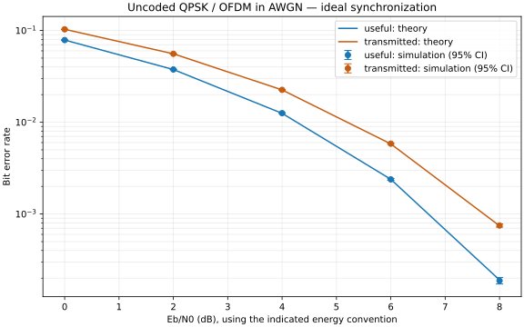
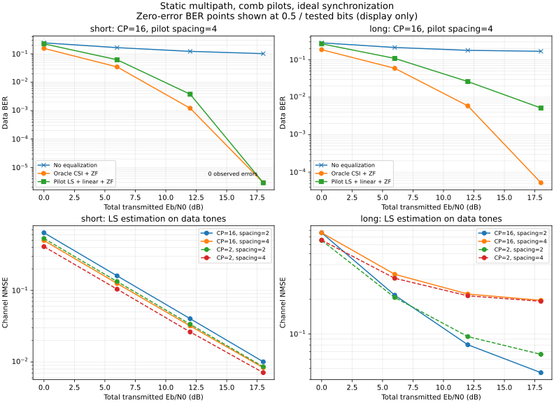
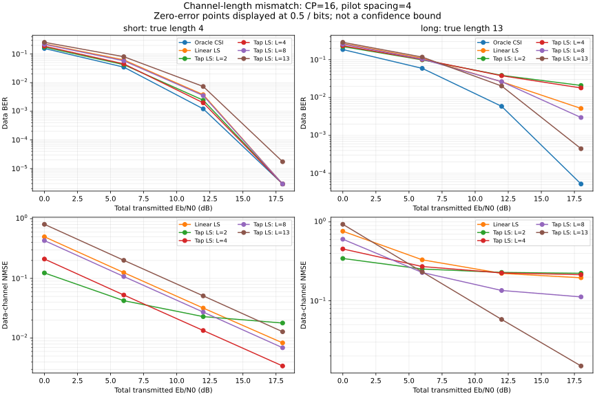
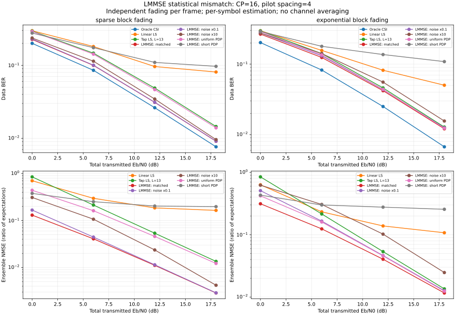
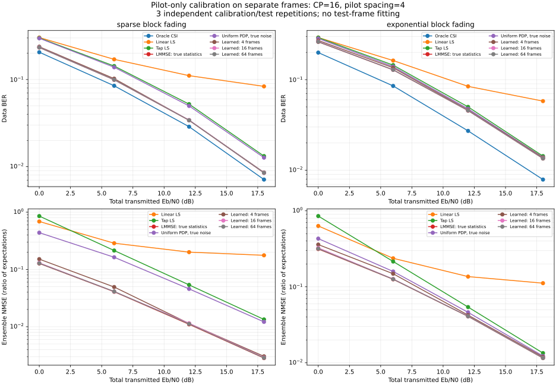
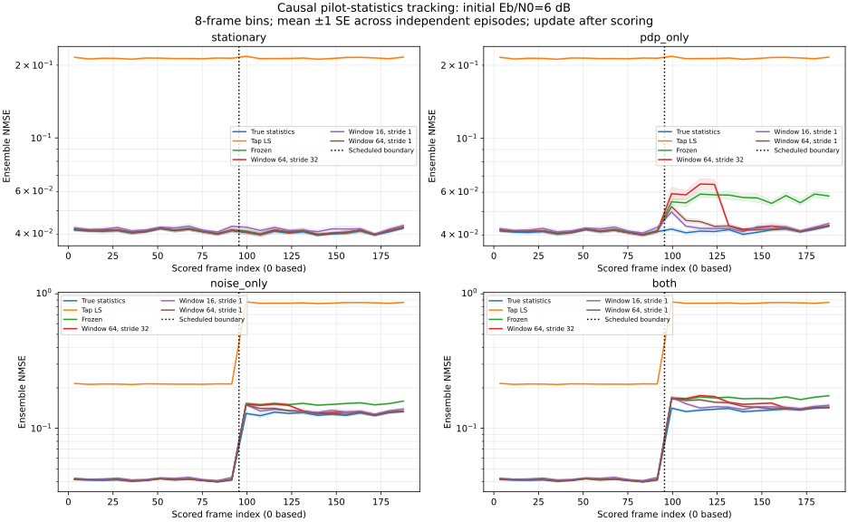
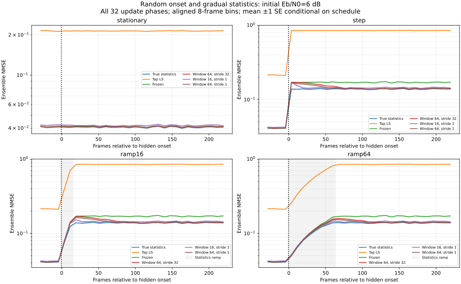
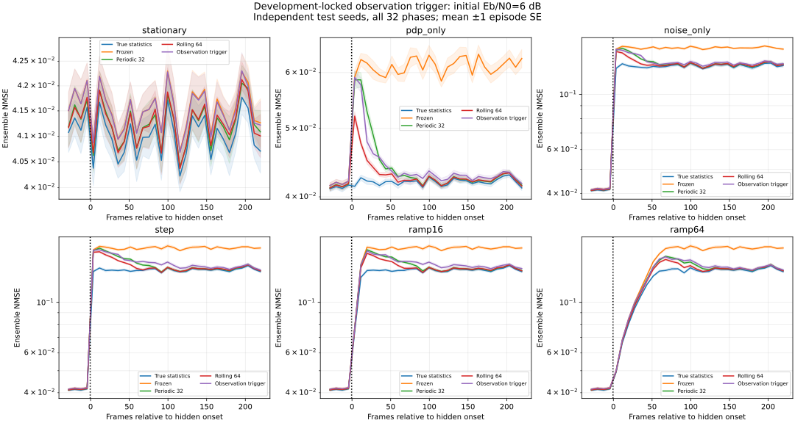
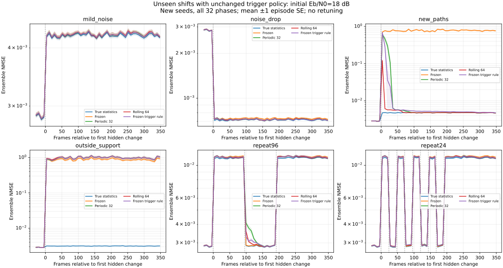

# WaveLink

面向多径与移动信道的 OFDM 接收机：建模、同步与鲁棒信道估计。

Reproducible wireless-link experiments for propagation-aware receiver design.

**状态：开发初期 / 项目实践。** 已完成 QPSK/OFDM 基础模块、复基带 AWGN 与理论 BER 对照，含循环前缀能量约定、独立重复及置信区间；现已加入多径、梳状导频、保护子载波、LS/时域 LS/LMMSE 与 ZF 均衡，并完成长度、噪声与 PDP 失配的基线比较。当前结果限于指定仿真模型，不包含硬件实测。

## 研究问题

当多径时延、移动条件和噪声统计发生变化时，接收机如何退化？低复杂度信道估计与跟踪方法能否改善可靠性、导频开销与计算成本之间的权衡？

第一条研究主线为信道统计失配。先建立可信基线，再比较 LS、DFT 去噪与 LMMSE；改进是否有效以可复现实验为准。

## 快速开始

要求 Python 3.11+。在仓库根目录运行：

```bash
python3 -m venv .venv
source .venv/bin/activate
python -m pip install -e .
python -m unittest discover -s tests -v
python examples/noiseless_loopback.py
```

Windows 使用 `.venv\Scripts\activate` 激活环境。

示例使用固定随机种子，发送 100 个 OFDM 符号、12,800 比特；无噪声、理想同步回环应得到 0 个比特错误。这只是基础正确性检查，不代表实际无线链路性能。

## 当前约定

- SISO 复基带离散时间模型；QPSK 平均符号能量为 1。
- IFFT/FFT 使用 `norm="ortho"`；子载波采用 NumPy 原生 FFT 顺序。
- AWGN 基线仍使用全数据子载波；多径实验采用独立资源栅格，包含 DC/保护子载波和导频。两者均未加入信道编码。
- 循环前缀（CP）长度按样本计。无噪声多径测试使用已知信道和理想符号边界。
- 传播模型不等于 Maxwell 方程全波求解；仿真数据不作为实测数据。

## 目录

```text
src/wavelink/       基带信号处理模块
tests/             能量、映射、回环与多径边界验证
examples/          可运行的最小示例
docs/roadmap.md     阶段范围与验收标准
docs/experiments.md 实验记录与公平比较约定
```

## 后续里程碑

1. **已完成**：AWGN 基线与理论 BER 对照，明确 SNR / Eb/N0 及开销定义。
2. **已完成**：静态多径、导频、LS 信道估计与均衡；同步误差和补偿尚待实现。
3. 信道统计失配下的算法对比、独立重复实验及失败边界。
4. 根据结果延伸到调制识别、SDR 回放/接收、无线边缘任务调度。

详见 [路线图](docs/roadmap.md) 和 [实验规范](docs/experiments.md)。

## 参考入口

- [GNU Radio: Basic OFDM Tutorial](https://wiki.gnuradio.org/index.php/Basic_OFDM_Tutorial)
- [NVIDIA Sionna: Neural Receiver](https://nvlabs.github.io/sionna/phy/tutorials/notebooks/Neural_Receiver.html)

上述资料作为参考，当前代码为基础模块实现，不宣称复现其完整系统。后续引入外部代码或数据时单独记录来源、版本及许可。

## AWGN 基线（已验证）

```bash
python -m pip install -e '.[plots]' -c experiments/requirements.txt
python experiments/awgn_ber.py --config experiments/awgn.json --output results/awgn --plot
```

默认进行 30 次固定预算仿真，10 个汇总点，每点 3,072,000 比特。`useful` 排除 CP 能量；`transmitted` 包含期望 CP 能量。两种约定须分别与各自理论曲线比较。



[方法、实际结果与局限](docs/awgn.md) · [汇总数据](reports/awgn/summary.csv) · [逐种子数据](reports/awgn/runs.csv) · [来源与环境](reports/awgn/metadata.json)

## 静态多径与导频接收（已验证）

```bash
python experiments/multipath_ber.py --output results/multipath --plot
```

比较不均衡、理想 CSI + ZF、导频 LS + 线性插值 + ZF。两种固定信道、两种 CP、两种导频密度、四个信噪比、三组种子；接收机共享发送数据、信道和噪声。21 项测试通过，CP 足够时的 16 个理想 CSI 汇总点通过理论回归检查。



[多径实验报告与边界](docs/multipath.md) · [结果](reports/multipath/summary.csv) · [无噪声诊断](reports/multipath/diagnostics.csv)

已知 CSI 只作为参考；无噪声插值仍可能有偏差。该阶段为静态离散多径仿真，尚未验证移动信道、频偏或硬件接收。

## 时域结构约束与长度失配（已验证）

```bash
python -m experiments.tapls_ber --output results/tapls --plot
```

采用部分 DFT 矩阵对导频观测做时域抽头 LS 拟合；比较长度 L=2/4/8/13 与线性插值。CP 固定为 16，避免把 CP 不足和长度先验错误混在一起。所有接收机共享样本，不依赖真实信道选取 L。



[公式、先验边界与结果](docs/tapls.md) · [汇总数据](reports/tapls/summary.csv) · [矩阵条件数与噪声放大](reports/tapls/geometry.csv)

27 项测试通过；64/64 偏差-方差一致性检查和 16/16 oracle BER 检查通过。时域约束并非总是更好：过短模型产生偏差，过长模型可能放大噪声。该实现是已有 LS 方法的可复现比较，不宣称新算法。

## LMMSE 与统计信息失配（已验证）

```bash
python -m experiments.lmmse_ber --output results/lmmse --plot
```

在每帧独立的随机块衰落中，对比线性 LS、时域 LS、准确统计信息的 LMMSE，以及噪声功率低估/高估 10 倍、PDP 均匀化或错误缩短的 LMMSE。共享链路样本，报告期望之比的 ensemble NMSE、BER 和帧级/配对标准误。



[模型、理论校验与实际结果](docs/lmmse.md) · [汇总数据](reports/lmmse/summary.csv) · [信号/噪声误差分解](reports/lmmse/predictions.csv)

33 项测试、112/112 估计器 NMSE 检查和 16/16 Oracle BER 检查通过。统计信息匹配可以改善均方误差，但错误 PDP 或噪声假设可使 LMMSE 劣于 LS。准确 PDP 是直接提供的理想统计基线，尚未从接收数据估计；本阶段随机信道与前阶段固定信道的 BER 不直接比较。

## 从导频学习统计信息（已验证）

```bash
python -m experiments.learned_ber --output results/learned --plot
```

用独立校准帧的导频差分估计噪声，使用抽头 LS 功率减去噪声贡献估计 PDP，再固定 LMMSE 在独立测试帧上评测。比较 4/16/64 帧校准预算，保留理想统计基线和部分先验消融。



[估计公式、隔离方式、开销与边界](docs/learned.md) · [测试结果](reports/learned/summary.csv) · [校准诊断](reports/learned/calibration.csv)

39 项测试、144/144 条件 NMSE 检查和 48/48 Oracle BER 检查通过。学习接口不接收真实 PDP 或噪声功率；仍需已知时延上界、帧内静态及校准/测试同分布。两层标准误分别反映给定模型后的测试波动和独立校准/测试重复的波动；目前只有 3 次独立校准重复，尚未验证统计漂移。

## 统计漂移与因果更新（已验证）

```bash
python -m experiments.drift_ber --output results/drift --plot
```

对照统计不变、仅 PDP 改变、仅噪声改变、两者同时改变；比较冻结模型、64 帧窗口每 32 帧更新、16/64 帧窗口每帧更新。先计分当前帧，再用其导频更新未来模型，接收机不知道真实变化时刻。



[时序、准确性检查、结果与成本](docs/drift.md) · [汇总及链路级 SE](reports/drift/summary.csv) · [更新次数和因果审计](reports/drift/costs.csv)

45 项测试、224/224 NMSE 残差检查和 32/32 Oracle BER 检查通过。每个配置做 12 次独立整段链路重复，不将重叠窗口或相关帧当成独立样本。小窗口恢复较快但可能增加稳定场景的误差，高信噪比下更新收益可能较小；实际噪声翻倍数会改变实际 Eb/N0，详见报告。

## 随机变化相位与缓变统计（已验证）

```bash
python -m experiments.robustness_ber --output results/robustness --plot
```

将周期更新的 32 种变化相位随机排列，分别指派给 32 个独立信道/噪声种子；比较统计不变、阶跃、16/64 帧功率统计渐变。预先固定相对变化点的 early/late 窗口，记录相对冻结模型和相对周期更新的配对误差。



[设计、分层 SE、结果和限制](docs/robustness.md) · [相位分配](reports/robustness/schedules.csv) · [汇总与配对结果](reports/robustness/summary.csv)

51 项测试、224/224 NMSE 检查及 32/32 Oracle BER 检查通过，并核对一段完整旧链路的保存结果。随机相位平均下，小窗口更快恢复但后期波动较大；周期更新以较少重建次数获得接近逐帧大窗口的 late 数值。尚未证明任意相位或真实移动信道中的优势。

## 开发流锁定阈值的观测触发更新（已验证）

```bash
python -m experiments.triggered_ber --output results/triggered --plot
```

用近期导频估计的噪声/PDP 偏差触发重建，缓存每帧矩统计，单独记录监测成本。阈值在 8 个开发种子的六场景、两档信噪比中选择并保存，再用 32 个独立测试种子覆盖全相位，不按测试结果调参。



[触发公式、选择规则、精度代价与成本](docs/triggered.md) · [冻结参数](reports/triggered/selection.json) · [测试结果](reports/triggered/summary.csv) · [误触发与延迟](reports/triggered/detection.csv)

阈值锁定为 0.75；57 项测试通过，独立测试的 336/336 NMSE 和 48/48 Oracle BER 检查通过。12 个测试条件的 post_all 平均 NMSE 均在周期策略的 1.05 倍内。平均每段重建 2.26 次，周期策略为 9 次；部分条件下 BER/NMSE 有小幅代价，未证明统计非劣效或总体加速。静态误触发、监测开销与测试分布限制均已报告。

## 冻结策略的未见分布审计（已验证）

```bash
python -m experiments.generalization_ber --output results/generalization --plot
```

保持阈值 0.75 和整个接收机源码不变，用新种子审计噪声幅度改变、上界内/外新路径、96/24 帧重复漂移。增加时延子空间理论下界，并按每次变化的可用区间统计有效更新。



[未见分布、绝对精度与失败边界](docs/generalization.md) · [结果](reports/generalization/summary.csv) · [逐次变化响应](reports/generalization/detection.csv) · [子空间下界](reports/generalization/capacity.csv)

64 项测试、336/336 NMSE 检查、48/48 Oracle BER 检查通过。12 个相对周期策略的均值参考项均通过，但延迟 15 超出 L=13 上界时，两者 BER 都很高；24 帧快速漂移也暴露有效更新缺失。相对基线接近不能替代绝对精度检查，失败样本与定义已完整保存。
