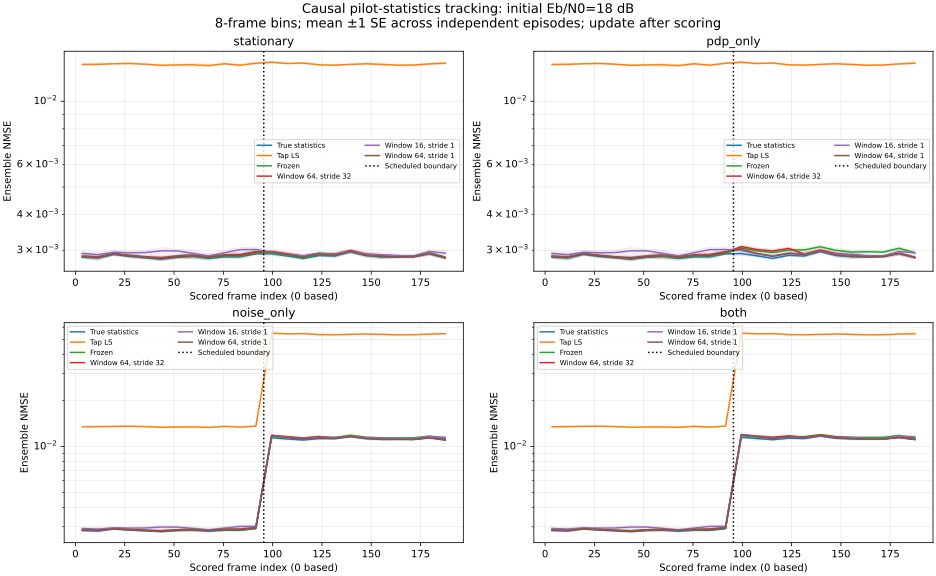

# 统计漂移下的因果更新与计算开销

本阶段研究：校准完成后 PDP 或噪声功率改变，冻结的 LMMSE 是否退化？固定周期和滑动窗口更新能恢复多少性能，代价是什么？这是已有矩估计与 LMMSE 的顺序评测，不是新算法或硬件测试。

## 场景和控制变量

沿用 64 点 SISO QPSK OFDM、Fs=1 MHz、CP=16、导频间隔 4（16 个导频、36 个数据子载波）、最大时延 12 样本。每帧生成独立复高斯抽头，帧内固定，抽头总体平均总功率为 1，不按每帧功率归一化。理想同步，不含频偏或连续多普勒。

初始真实 PDP 在时延 0/4/12 处的功率为 0.80/0.12/0.08；改变后为 0.10/0.20/0.70。这里改变功率分配，非零时延位置保持不变，尚未覆盖新路径出现或支撑上界失效。

每段链路先收集 64 个独立校准帧，再连续计分 192 帧，每帧第一个符号预热、20 个符号计分。四种场景从帧索引 96 起按预定配置切换：

| 场景 | PDP | 噪声 |
|---|---|---|
| stationary | 不变 | 不变 |
| pdp_only | 改为晚到路径占优 | 不变 |
| noise_only | 不变 | 真实 N0 变为 4 倍 |
| both | 改为晚到路径占优 | 真实 N0 变为 4 倍 |

初始总发送 Eb/N0 为 6 或 18 dB。发送功率保持不变，因此噪声翻 4 倍后，实际 Eb/N0 下降 `10 log10(4)=6.0206 dB`，分别为约 -0.0206/11.9794 dB。图中的初始 Eb/N0 标签不能当作改变后的信噪比。即使有准确统计先验，物理噪声增加也会使 BER 变差。

## 更新策略与时序

所有学习策略都使用完整 64 帧初始校准拟合同一个初始模型，避免小窗口策略一开始就获得不同的校准预算。随后只使用已经计分的帧导频。当前帧仍用更新前的统计矩阵做逐符号信道估计：

1. 使用截至 t-1 帧可获得的统计信息，形成 A[t]。
2. 用当前帧已知导频估计 H，再解调计分；当前帧的真值只供评测。
3. 计分后才把当前导频观测加入统计窗口，必要时重建模型，最早供 t+1 帧使用。

`CausalPilotLMMSE` 强制 `estimate() → advance()` 顺序；重复 estimate 或没有待处理观测就 advance 会报错。类只接收导频观测、栅格、时延上界、窗口和更新周期，不接收真实 PDP、真实噪声、场景或变化时刻。内部保存当前帧观测的副本，后续修改调用方数组不能改变已排队数据。

| 策略 | 更新时使用的窗口 | 更新间隔 |
|---|---:|---:|
| frozen | 初始 64 帧模型永久固定 | 无 |
| periodic_64_32 | 最近 64 帧 | 每 32 帧 |
| rolling_16 | 最近 16 帧 | 每帧 |
| rolling_64 | 最近 64 帧 | 每帧 |

早期窗口包含初始校准池的最近帧，后续逐步换入已计分帧。噪声/PDP 估计公式沿用 [导频统计学习阶段](learned.md)，包括不重叠符号差分、LS 抽头矩估计、噪声扣除和固定 `1e-12` 数值下界。没有变化检测器，也没有按测试结果选择窗口。周期从测试链路开始时计数，不在变化点重置；本次预定变化点恰好与 32 帧周期边界对齐，其他变化相位尚未评测。

参考方法包括真实瞬时 CSI、每帧真实总体统计的 LMMSE、线性 LS 和 L=13 的时域 LS。真实统计 LMMSE 在场景边界切换，是理想信息参考，不是可部署更新策略。当前方法都逐符号估计，未做当前帧信道时间平均。

## 随机流、指标与准确性检查

每种“场景 × 初始信噪比”做 12 次独立整段链路重复。随机流为 `SeedSequence([seed, snr_index, role])`，role=1 初始校准、role=2 测试序列。场景之间共享同一 seed/snr 的潜在随机抽样，使变化前数据完全一致，变化后控制统计参数；场景不是相互独立的重复。

每种方法共享同一物理场景中的数据、导频、信道和噪声。共按场景运行 96 段链路、18,432 个计分帧、26,542,080 个场景计分比特。由于四个场景复用发送比特流，独立 seed/snr 潜在流只有 24 组，包含 6,635,520 个发送比特；不能把场景重复计分称为更多独立比特。64 帧初始校准池也在四场景复用，独立 seed/snr 下共 1536 帧。

NMSE 沿用期望之比口径，真实总体平均信道功率为 1。给定历史统计矩阵 A[t] 后，当前帧独立，理论预测仍为

`(||(A[t] Fp-Fd) R[t]^(1/2)||F² + N0[t] ||A[t]||F²) / Nd`。

代码在当前帧计分前保存 A[t] 并计算预测；真 R/N0 仅进入评价器。每帧断言 `last_update_after_frame < t`、`frames_observed == t`。保存的所有策略因果审计值 `maximum_training_lead` 均为 -1。

滑动窗口重叠且模型由历史数据驱动，因此不以单帧独立假设计算 SE。对每个阶段先在一段链路内平均，再对 12 个独立链路均值计算标准误。配对 BER/NMSE 差先在同一链路中减去 frozen，再跨独立链路计算 SE。理论一致性也对每段链路内的“观测 NMSE 减预测”平均后计算 SE。预设工程检查为 `|平均残差| <= 6 × 链路级 SE + 1e-10`，未作多重比较显著性校正。

阶段为 pre=0..95、post_early=96..159、post_late=160..191、post_all=96..191。post_all 与 early/late 重叠，不能将这些行合计为额外独立样本。图按 8 帧分箱，再显示 12 段链路的均值 ±1 SE；阴影不是 95% 置信区间。逐次拟合诊断只在选定检查点保存，并非所有更新事件日志，检查点不会触发策略更新。

## 结果与限制

共 3072 行逐链路阶段结果、256 个汇总点。224/224 个非 Oracle NMSE 残差检查、32/32 Oracle BER 检查通过。45 项自动测试通过，覆盖同一初始模型、先计分后更新、未来后缀不能改变过去输出、周期更新次数、窗口内存上界及场景变化前数据完全一致等检查。

下表为 both 场景、初始 6 dB、改变后实际约 -0.0206 dB、post_late 的结果。每种方法计分 552,960 比特；± 后为相对 frozen 的配对 BER 差的 1 SE，负值表示 BER 较低。

| 方法 | BER | ensemble NMSE | BER 差（方法 − frozen） |
|---|---:|---:|---:|
| frozen | 0.238330 | 0.169964 | 0 |
| periodic_64_32 | 0.233216 | 0.141462 | -0.005114 ± 0.000536 |
| rolling_16 | 0.233672 | 0.144303 | -0.004659 ± 0.000643 |
| rolling_64 | 0.233115 | 0.141129 | -0.005216 ± 0.000543 |
| 真实统计 LMMSE | 0.232838 | 0.139935 | -0.005492 ± 0.000527 |

早期 post_early 中，rolling_16 的 NMSE 为 0.147405，rolling_64 为 0.153688，periodic 为 0.161854：小窗口较快替换旧统计，但后期小窗口误差较大，符合较少样本带来的波动。这里是固定配置的描述性比较，没有通过测试选择“最佳”窗口。

stationary 场景、初始 6 dB、post_early 中，rolling_16 NMSE=0.041850，高于 frozen 的 0.040737；相对 frozen 的配对 BER 差为 `+0.00037254 ± 0.00008713`（1 SE）。持续更新并不总能改善表现。

在 18 dB 的 PDP-only 场景，late NMSE 从 frozen 的 0.002977 变为 rolling_64 的 0.002866，BER 从 0.008581 变为 0.008567，BER 差相对 SE 很小，不能称为明确的 BER 改善。本次 PDP 变化保持同一时延集合，在高信噪比下正则化差异较弱，与这种结果相符。完整保存两个初始信噪比，避免仅展示收益较大的设置。




## 更新成本

每段链路只有 191 次可影响后续预测的更新机会；最后一帧不做无后续用途的更新。历史窗口的复数值数量不包括模型矩阵、临时数组和 Python 对象，因此不是进程内存测量。

| 策略 | 重建次数 | 累计拟合帧访问数 | 历史窗口复数值数 |
|---|---:|---:|---:|
| frozen | 0 | 0 | 20480 |
| periodic_64_32 | 5 | 320 | 20480 |
| rolling_16 | 191 | 3056 | 5120 |
| rolling_64 | 191 | 12224 | 20480 |

周期更新在该 late 配置下得到接近逐帧更新的数值，使用更少模型重建，但恢复速度和变化相位会影响结论。所有策略复用既有导频，更新不额外发送校准帧；初始 64 帧校准相同，均需 1344 个 OFDM 发送符号（包含预热）。尚未验证导频减少或有效吞吐率收益。

`costs.csv` 同时记录 `perf_counter_ns` 测得的初始拟合/累计更新毫秒数，包含统计拟合与 LMMSE 构造；这些只是同一次运行的诊断，没有独立预热、固定线程控制和系统负载隔离，不能当成正式延迟基准。实际线程环境记录在 metadata 中。当前实现每次重新拟合，尚未优化为增量充分统计量更新。

## 复现

```bash
python -m pip install -e '.[plots]' -c experiments/requirements.txt
python -m unittest discover -s tests -v
python -m experiments.drift_ber --output results/drift --plot
```

[逐链路阶段结果](../reports/drift/runs.csv) · [汇总与配对 SE](../reports/drift/summary.csv) · [分箱时间轨迹](../reports/drift/trace.csv) · [成本和因果审计](../reports/drift/costs.csv) · [检查点更新诊断](../reports/drift/update_events.csv) · [命令、配置与源码哈希](../reports/drift/metadata.json)

metadata 的 base_commit 为生成结果前的父提交，dirty 标记表示运行时未提交，源码哈希明确此次实际代码。数值结果应可复现，计时、平台信息与 SVG 元数据可能不同。

尚未覆盖变化时刻随机化、连续缓变统计、帧内多普勒、相关抽头、新路径出现、时延上界错误、频偏、真实采集和硬件部署。下阶段适合先随机化变化相位/速度，再评测基于观测的更新触发机制及增量计算，不能仅凭本次单一切换时刻宣称普遍鲁棒。

顺序评测的参考：[River 官方 progressive validation 实现](https://github.com/online-ml/river/blob/main/river/evaluate/progressive_validation.py)展示先预测、评价、再学习的时序。本项目未引入 River 依赖，通信统计估计仍使用上一阶段明确推导的公式。
