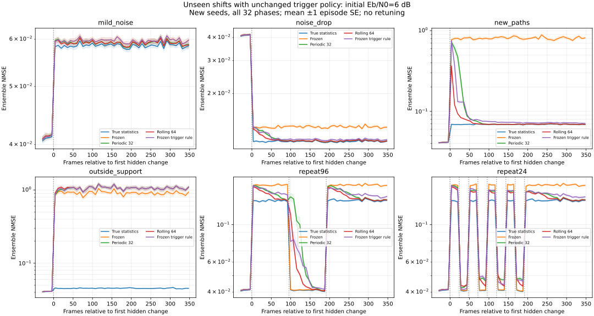

# 冻结观测触发策略的未见分布审计

本阶段保持上一阶段在开发流选出的阈值和整个接收机实现不变，加入未用于选择阈值的噪声幅度、新时延分布和重复漂移。目的在于寻找适用范围与失败边界，不用新结果重新调参。

## 冻结内容和数据隔离

读取版本化的 `reports/triggered/selection.json`，核对其 SHA-256 和原协议配置哈希，再核对该选择记录中的所有 `src/` 接收机源码哈希。因此阈值仍是 **0.75**，拟合窗口 64、监测窗口 16、检查间隔 8、冷却 32；原有矩估计、LMMSE、调制、栅格和触发器代码都没有改变。扩展的是生成器和评价器。

新信道/噪声种子为 111001..111032，与旧开发 81001..81008、旧测试 91001..91032 不重合。schedule_seed=112001 随机排列全部 32 种相位，起点为 64+phase，在每个场景和两个初始 Eb/N0 中复用同一分配。

SISO QPSK、64 点 OFDM、16 个导频、36 个数据子载波、Fs=1 MHz、CP=16 不变；每段链路初始校准 64 帧，再计分 448 帧，每帧 20 个计分符号加一个预热符号。每帧独立生成零均值不相关复高斯抽头，帧内固定，始终保持总体平均总功率为 1，不进行逐帧功率归一化。尚未加入连续相关衰落、多普勒、频偏或硬件测量。

所有新测试帧都使用统一的 16 长度真实 PDP 数组，短支撑尾部补零，以便场景之间复用相同数量和顺序的潜在随机抽样。校准仍来自旧的三路径初始分布。所有接收机在同一场景中共享发送数据、信道和噪声；运行时触发器不知道场景、变化时刻、真实噪声或 PDP。

## 预设未见场景

初始 PDP 仍在延迟 0/4/12 样本处取功率 0.80/0.12/0.08。旧终值在这些位置为 0.10/0.20/0.70。新状态为：

- new_paths：延迟 0/2/6/10/12，功率 0.10/0.20/0.40/0.20/0.10，新增路径仍在估计器的 0..12 上界内。
- outside_support：延迟 0/4/15，功率 0.10/0.20/0.70。估计器仍只包含 0..12；真实最大时延 15 小于等于 CP=16，因此与 CP 不足问题分开。

| 场景 | 与开发分布的差异 |
|---|---|
| mild_noise | 只将 N0 提高到初始的 1.5 倍；开发时只测过提高 4 倍 |
| noise_drop | 只将 N0 降到初始的 0.25 倍；开发时没有噪声下降 |
| new_paths | 改为 new_paths，噪声不变；检验已知支撑内新路径 |
| outside_support | 改为 outside_support，噪声不变；故意违反 L=13 的上界先验 |
| repeat96 | 相对帧 0/96/192 在“旧终值+4倍噪声”和“初始+原噪声”间交替 |
| repeat24 | 相对帧 0/24/48/…/192 共九次交替，变化间隔短于拟合窗口和冷却期 |

初始 Eb/N0 为 6/18 dB。mild_noise 后实际值降低 1.7609 dB；noise_drop 后提高 6.0206 dB；两个新路径场景实际值不变；重复漂移在初始值与降低 6.0206 dB 的值之间切换。不能将这些物理难度不同的场景的绝对 BER 直接用于比较算法优劣，只在同场景共享数据中做配对比较。

## 计分、响应和不确定性

仍先估计和计分当前帧，再使用当前导频更新下一帧模型。理论 NMSE 用计分前 A[t] 与当前真实总体统计计算；理想统计参考获得真实支撑，学习策略和时域 LS 继续使用 L=13。真实 CSI 参考直接获得瞬时频率响应。

评价窗口预先固定为相对起点：pre=-32..-1、early=0..63、late=288..351、post_all=0..351。late 在最后一次变化之后留有 96 帧，但不保证事件策略已触发或恢复。与上一阶段不同，post_all 从 224 扩展到 352 帧以包含重复变化的尾部；复用 1.05 的均值比作为描述性参考，不宣称这是原来 224 帧开发约束的同等认证。

响应按每次变化的状态区间单独计算。只有在变化后重建、且新模型在下一次变化前开始生效，才计为该区间的有效更新。例如在帧 23 计分后重建、帧 24 又发生新变化，则这个模型既不算上一状态的有效应用，也不算使用了新变化观测的响应。更新不重复分配给多个变化。

`detection.csv` 区分首次有效更新延迟、区间内没有有效更新、64 帧内没有有效更新，以及可观测区间长度。24 帧快速变化只能提供最多 23 帧的有效应用延迟，不能按完整 64 帧检测窗口解读。固定周期/逐帧策略的重建时刻由既定排程重建，并核对总次数；触发策略使用实际逐次事件日志。即使发生有效重建，也不保证模型已准确跟踪；未重建也不必然导致明显性能下降。

每个条件有 32 条独立信道/噪声链路，给定固定分层相位分配后按整段链路计算 SE。重复变化不是独立样本，场景之间共享潜在随机流，重叠评价窗口不能累加。六 SE 理论回归检查与上一阶段一致，不是多重比较校正后的显著性检验。

## 时延子空间容量诊断

当输出受限于 `Fd_assumed` 的列空间时，即使有真实信道信息，其期望数据误差也至少为

`|| (I - Fd_assumed Fd_assumed†) Fd_true diag(sqrt(p)) ||F² / Nd`。

这是允许系数获得 oracle 信息的**数据子空间投影下界**，不是对实际导频估计器可达到性能的承诺。当前总体平均功率为 1，所以该式是 ensemble NMSE 的下界。L=13 的时域 LS 与学习得到的 LMMSE 均输出在这个子空间内；真实统计参考不受该错误上界限制。

初始、旧终值和 new_paths 的该下界在数值零附近（约 1e-30）。outside_support 的下界为 **0.457708865**。因此其误差不可能仅通过同一 L=13 模型更勤快更新就全部消除。该结论针对期望误差，有限样本的观测均值可能有抽样波动。自动测试核对投影残差的正交性，并确认时域 LS 的理论误差不低于该下界。

## 本次结果与失败边界

64 项自动测试通过，新增检查包括延迟 15、CP=16 下的无噪声 OFDM 对角模型与零误码验证，避免把模型上界失配误判为 CP 或实现错误。336/336 非 Oracle NMSE 理论残差检查、48/48 Oracle BER 检查通过。原阈值、监测参数及接收机源码在运行前后均保持一致。

六场景、两档信噪比、32 个独立种子，共按场景计分 384 段链路、172,032 帧、247,726,080 比特。场景共享潜在随机流，独立 seed/snr 流为 64 组，包含 41,287,680 个发送比特，不将重复场景计为更多独立比特。保存 12,288 行链路阶段结果、384 个汇总点和逐变化响应记录。

**相对对照达标不等于绝对精度足够。** 12/12 个 post_all 条件的 triggered/periodic 平均 NMSE 比均小于 1.05，最差为 repeat24、初始 6 dB 的 1.01512；但 outside_support 中两种方法都使用错误的上界，误差接近，均表现很差。

下表为两个路径场景、18 dB、post_all=352 帧，噪声未改变；每种方法、每个场景计分 16,220,160 比特：

| 场景 | 方法 | BER | ensemble NMSE |
|---|---|---:|---:|
| 新路径仍在上界内 | periodic | 0.023665 | 0.038244 |
| 新路径仍在上界内 | triggered | 0.019576 | 0.028286 |
| 新路径仍在上界内 | 真实统计参考 | 0.009459 | 0.004783 |
| 延迟超出上界 | periodic | 0.361210 | 0.983759 |
| 延迟超出上界 | triggered | 0.361580 | 0.983997 |
| 延迟超出上界 | 真实统计参考 | 0.008453 | 0.003132 |

上界内 triggered 相对 periodic 的 NMSE 配对差为 `-0.00995779 ± 0.00420868`（1 SE），结果限于本次给定协议及样本。逐帧大窗口在该条件下仍明显更接近真实统计参考，不能把触发更新称为最优接收机。

越界情况下，所有 L=13 的方法都受前述 0.457709 的期望子空间下界限制；实际约 0.984 还包含导频拟合、错误统计和噪声传播误差，与较乐观的投影下界不矛盾。真实统计参考可以使用真实 16 长度支撑，信息条件不同，只用于定位结构性问题。该失败不能通过改写阈值或增加同一模型的更新次数来解释成已经解决。

快速重复变化的响应缺失如下，两档信噪比合计。这里是状态区间的操作计数，不是独立二项样本，也不是假设检验的漏检率。

| 场景 | 策略 | 状态区间数 | 区间内无有效更新 | 未在 64 帧或可用区间内更新 |
|---|---|---:|---:|---:|
| repeat96 | periodic | 192 | 0 | 0 |
| repeat96 | triggered | 192 | 0 | 0 |
| repeat24 | periodic | 576 | 144 | 144 |
| repeat24 | triggered | 576 | 231 | 237 |
| repeat24 | rolling_64 | 576 | 0 | 0 |

repeat24 的 24 帧间隔小于触发器 32 帧冷却期和 64 帧拟合窗口；有效更新覆盖不足符合这些约束。逐帧策略虽然每个区间都重建，但窗口仍混合不同统计，不代表已准确恢复。在初始 6 dB 的 repeat24 中，post_all BER 为 periodic 0.196595、triggered 0.196912；配对差为 `+0.00031751 ± 0.00005488`（1 SE），平均误差参考项通过仍有可见代价。

**没有触发也不必然导致明显劣化。** mild_noise 的 64 条链路中，54 条在整个变化后区间没有有效重建，62 条没有在 64 帧内重建；但初始 6 dB 的 post_all NMSE 比仅为 1.00835。该弱变化通常达不到原启发式阈值，精度影响在本次配置中较小。相反，越界场景全部在变化后重建，也不能突破模型容量限制。

本次 triggered 每段平均重建 3.578125 次（0..9），periodic 固定 13 次、rolling 固定 447 次。代价、精度、变化覆盖三者需要同时报告，不能由重建较少推导总体算力或延迟改善。




## 成本、复现和结果文件

每段 448 帧最多执行 447 次能影响未来预测的更新。周期策略每 32 帧重建，共 13 次；逐帧策略 447 次；触发策略另有 447 次在线特征累积、55 次监测检查，初始化还处理 64 帧特征。计时仅为诊断，不把矩阵重建减少解释为整体加速。

```bash
python -m pip install -e '.[plots]' -c experiments/requirements.txt
python -m unittest discover -s tests -v
python -m experiments.generalization_ber --output results/generalization --plot
```

[逐链路阶段结果](../reports/generalization/runs.csv) · [汇总与配对 SE](../reports/generalization/summary.csv) · [描述性均值参考](../reports/generalization/gates.csv) · [每次变化响应](../reports/generalization/detection.csv) · [事件日志](../reports/generalization/events.csv) · [真实变更排程](../reports/generalization/schedules.csv) · [子空间下界](../reports/generalization/capacity.csv) · [成本与因果审计](../reports/generalization/costs.csv) · [锁定记录与源码哈希](../reports/generalization/metadata.json)

原选择文件在运行前后均核验，接收机源码完全不变。metadata 的 base_commit 为运行前父提交，用源码 SHA-256 明确此次实际代码；计时、平台字段、UTC 时间和 SVG 元数据可能不同。任何失败都会保留，不据新场景改阈值或重选种子。

## 下一步的研究边界

当前审计已经保留支持失败与快速变化覆盖不足，未按新数据改阈值。进一步改进应作为新版本，在独立开发流中设计时延上界失配告警、模型扩展或回退，并用新的保留测试流验证。数据驱动修改后的方法不能继续沿用本批已查看数据声称独立泛化，也不能只用相对一个同样失配的基线的 5% 条件判断接收机是否可用。
