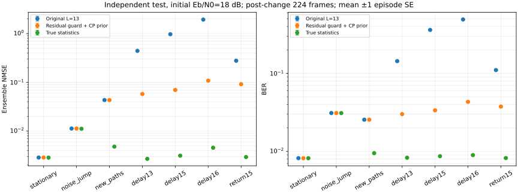
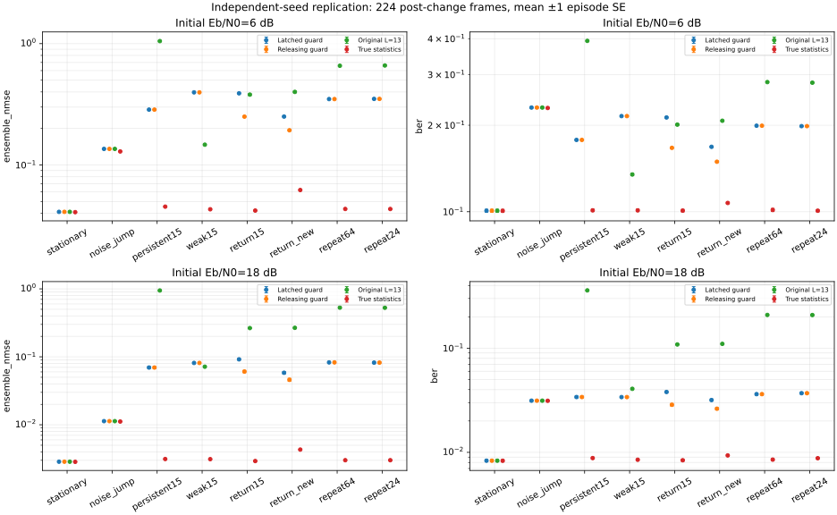
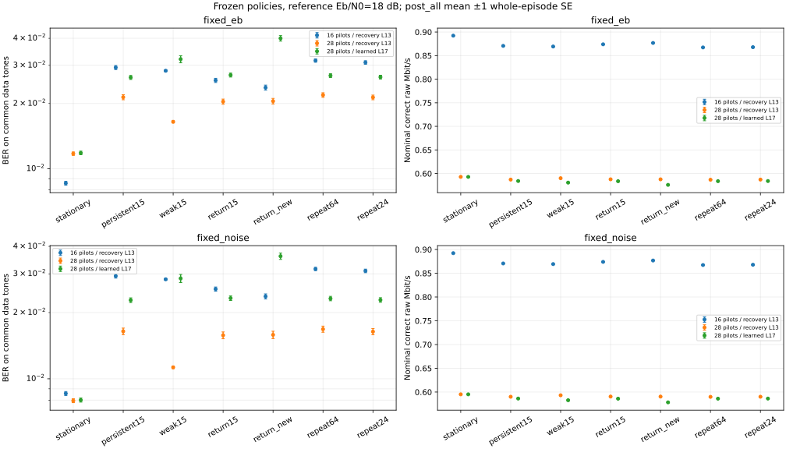
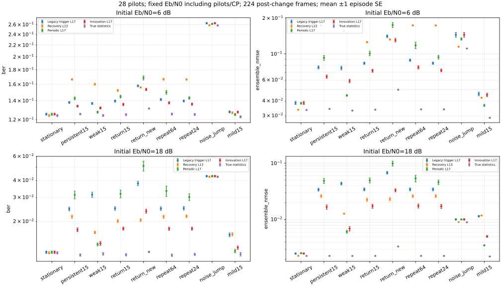
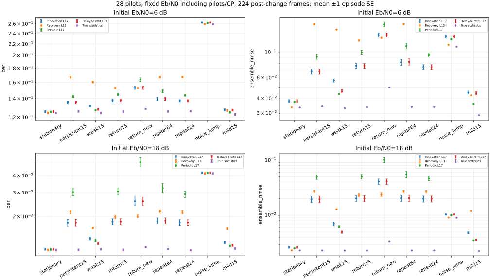

# 阶段记录归档（v0.01–v0.20）

以下保留各阶段当时的介绍与结果，其中“尚未实现”等状态属于历史记录。当前功能、实验入口和限制以[项目首页](../README.md)与[报告索引](index.md)为准。

# WaveLink

面向多径与移动信道的 OFDM 接收机：建模、同步与鲁棒信道估计。

Reproducible wireless-link experiments for propagation-aware receiver design.

**状态：开发初期 / 项目实践。** 已完成 QPSK/OFDM 基础模块、复基带 AWGN 与理论 BER 对照，含循环前缀能量约定、独立重复及置信区间；现已加入多径、梳状导频、保护子载波、LS/时域 LS/LMMSE 与 ZF 均衡，并完成长度、噪声与 PDP 失配的基线比较。当前结果限于指定仿真模型，不包含硬件实测。

## 研究问题

当多径时延、移动条件和噪声统计发生变化时，接收机如何退化？低复杂度信道估计与跟踪方法能否改善可靠性、导频开销与计算成本之间的权衡？

第一条研究主线为信道统计失配。先建立可信基线，再比较 LS、DFT 去噪与 LMMSE；改进是否有效以可复现实验为准。

## 快速开始

要求 Python 3.11+。在仓库根目录运行：

```bash
python3 -m venv .venv
source .venv/bin/activate
python -m pip install -e .
python -m unittest discover -s tests -v
python examples/noiseless_loopback.py
```

Windows 使用 `.venv\Scripts\activate` 激活环境。

示例使用固定随机种子，发送 100 个 OFDM 符号、12,800 比特；无噪声、理想同步回环应得到 0 个比特错误。这只是基础正确性检查，不代表实际无线链路性能。

## 当前约定

- SISO 复基带离散时间模型；QPSK 平均符号能量为 1。
- IFFT/FFT 使用 `norm="ortho"`；子载波采用 NumPy 原生 FFT 顺序。
- AWGN 基线仍使用全数据子载波；多径实验采用独立资源栅格，包含 DC/保护子载波和导频。两者均未加入信道编码。
- 循环前缀（CP）长度按样本计。无噪声多径测试使用已知信道和理想符号边界。
- 传播模型不等于 Maxwell 方程全波求解；仿真数据不作为实测数据。

## 目录

```text
src/wavelink/       基带信号处理模块
tests/             能量、映射、回环与多径边界验证
examples/          可运行的最小示例
docs/roadmap.md     阶段范围与验收标准
docs/experiments.md 实验记录与公平比较约定
```

## 后续里程碑

1. **已完成**：AWGN 基线与理论 BER 对照，明确 SNR / Eb/N0 及开销定义。
2. **已完成**：静态多径、导频、LS 信道估计与均衡；同步误差和补偿尚待实现。
3. **已完成阶段验证**：信道统计失配对比、导频统计学习与因果跟踪、冻结分布审计和支撑失配告警；恢复后的模型选择仍待改进。
4. 根据结果延伸到调制识别、SDR 回放/接收、无线边缘任务调度。

详见 [路线图](roadmap.md) 和 [实验规范](experiments.md)。

## 参考入口

- [GNU Radio: Basic OFDM Tutorial](https://wiki.gnuradio.org/index.php/Basic_OFDM_Tutorial)
- [NVIDIA Sionna: Neural Receiver](https://nvlabs.github.io/sionna/phy/tutorials/notebooks/Neural_Receiver.html)

上述资料作为参考，当前代码为基础模块实现，不宣称复现其完整系统。后续引入外部代码或数据时单独记录来源、版本及许可。

## AWGN 基线（已验证）

```bash
python -m pip install -e '.[plots]' -c experiments/requirements.txt
python experiments/awgn_ber.py --config experiments/awgn.json --output results/awgn --plot
```

默认进行 30 次固定预算仿真，10 个汇总点，每点 3,072,000 比特。`useful` 排除 CP 能量；`transmitted` 包含期望 CP 能量。两种约定须分别与各自理论曲线比较。


[方法、实际结果与局限](awgn.md) · [汇总数据](../reports/awgn/summary.csv) · [逐种子数据](../reports/awgn/runs.csv) · [来源与环境](../reports/awgn/metadata.json)

## 静态多径与导频接收（已验证）

```bash
python experiments/multipath_ber.py --output results/multipath --plot
```

比较不均衡、理想 CSI + ZF、导频 LS + 线性插值 + ZF。两种固定信道、两种 CP、两种导频密度、四个信噪比、三组种子；接收机共享发送数据、信道和噪声。21 项测试通过，CP 足够时的 16 个理想 CSI 汇总点通过理论回归检查。


[多径实验报告与边界](multipath.md) · [结果](../reports/multipath/summary.csv) · [无噪声诊断](../reports/multipath/diagnostics.csv)

已知 CSI 只作为参考；无噪声插值仍可能有偏差。该阶段为静态离散多径仿真，尚未验证移动信道、频偏或硬件接收。

## 时域结构约束与长度失配（已验证）

```bash
python -m experiments.tapls_ber --output results/tapls --plot
```

采用部分 DFT 矩阵对导频观测做时域抽头 LS 拟合；比较长度 L=2/4/8/13 与线性插值。CP 固定为 16，避免把 CP 不足和长度先验错误混在一起。所有接收机共享样本，不依赖真实信道选取 L。


[公式、先验边界与结果](tapls.md) · [汇总数据](../reports/tapls/summary.csv) · [矩阵条件数与噪声放大](../reports/tapls/geometry.csv)

27 项测试通过；64/64 偏差-方差一致性检查和 16/16 oracle BER 检查通过。时域约束并非总是更好：过短模型产生偏差，过长模型可能放大噪声。该实现是已有 LS 方法的可复现比较，不宣称新算法。

## LMMSE 与统计信息失配（已验证）

```bash
python -m experiments.lmmse_ber --output results/lmmse --plot
```

在每帧独立的随机块衰落中，对比线性 LS、时域 LS、准确统计信息的 LMMSE，以及噪声功率低估/高估 10 倍、PDP 均匀化或错误缩短的 LMMSE。共享链路样本，报告期望之比的 ensemble NMSE、BER 和帧级/配对标准误。


[模型、理论校验与实际结果](lmmse.md) · [汇总数据](../reports/lmmse/summary.csv) · [信号/噪声误差分解](../reports/lmmse/predictions.csv)

33 项测试、112/112 估计器 NMSE 检查和 16/16 Oracle BER 检查通过。统计信息匹配可以改善均方误差，但错误 PDP 或噪声假设可使 LMMSE 劣于 LS。准确 PDP 是直接提供的理想统计基线，尚未从接收数据估计；本阶段随机信道与前阶段固定信道的 BER 不直接比较。

## 从导频学习统计信息（已验证）

```bash
python -m experiments.learned_ber --output results/learned --plot
```

用独立校准帧的导频差分估计噪声，使用抽头 LS 功率减去噪声贡献估计 PDP，再固定 LMMSE 在独立测试帧上评测。比较 4/16/64 帧校准预算，保留理想统计基线和部分先验消融。


[估计公式、隔离方式、开销与边界](learned.md) · [测试结果](../reports/learned/summary.csv) · [校准诊断](../reports/learned/calibration.csv)

39 项测试、144/144 条件 NMSE 检查和 48/48 Oracle BER 检查通过。学习接口不接收真实 PDP 或噪声功率；仍需已知时延上界、帧内静态及校准/测试同分布。两层标准误分别反映给定模型后的测试波动和独立校准/测试重复的波动；目前只有 3 次独立校准重复，尚未验证统计漂移。

## 统计漂移与因果更新（已验证）

```bash
python -m experiments.drift_ber --output results/drift --plot
```

对照统计不变、仅 PDP 改变、仅噪声改变、两者同时改变；比较冻结模型、64 帧窗口每 32 帧更新、16/64 帧窗口每帧更新。先计分当前帧，再用其导频更新未来模型，接收机不知道真实变化时刻。


[时序、准确性检查、结果与成本](drift.md) · [汇总及链路级 SE](../reports/drift/summary.csv) · [更新次数和因果审计](../reports/drift/costs.csv)

45 项测试、224/224 NMSE 残差检查和 32/32 Oracle BER 检查通过。每个配置做 12 次独立整段链路重复，不将重叠窗口或相关帧当成独立样本。小窗口恢复较快但可能增加稳定场景的误差，高信噪比下更新收益可能较小；实际噪声翻倍数会改变实际 Eb/N0，详见报告。

## 随机变化相位与缓变统计（已验证）

```bash
python -m experiments.robustness_ber --output results/robustness --plot
```

将周期更新的 32 种变化相位随机排列，分别指派给 32 个独立信道/噪声种子；比较统计不变、阶跃、16/64 帧功率统计渐变。预先固定相对变化点的 early/late 窗口，记录相对冻结模型和相对周期更新的配对误差。


[设计、分层 SE、结果和限制](robustness.md) · [相位分配](../reports/robustness/schedules.csv) · [汇总与配对结果](../reports/robustness/summary.csv)

51 项测试、224/224 NMSE 检查及 32/32 Oracle BER 检查通过，并核对一段完整旧链路的保存结果。随机相位平均下，小窗口更快恢复但后期波动较大；周期更新以较少重建次数获得接近逐帧大窗口的 late 数值。尚未证明任意相位或真实移动信道中的优势。

## 开发流锁定阈值的观测触发更新（已验证）

```bash
python -m experiments.triggered_ber --output results/triggered --plot
```

用近期导频估计的噪声/PDP 偏差触发重建，缓存每帧矩统计，单独记录监测成本。阈值在 8 个开发种子的六场景、两档信噪比中选择并保存，再用 32 个独立测试种子覆盖全相位，不按测试结果调参。


[触发公式、选择规则、精度代价与成本](triggered.md) · [冻结参数](../reports/triggered/selection.json) · [测试结果](../reports/triggered/summary.csv) · [误触发与延迟](../reports/triggered/detection.csv)

阈值锁定为 0.75；57 项测试通过，独立测试的 336/336 NMSE 和 48/48 Oracle BER 检查通过。12 个测试条件的 post_all 平均 NMSE 均在周期策略的 1.05 倍内。平均每段重建 2.26 次，周期策略为 9 次；部分条件下 BER/NMSE 有小幅代价，未证明统计非劣效或总体加速。静态误触发、监测开销与测试分布限制均已报告。

## 冻结策略的未见分布审计（已验证）

```bash
python -m experiments.generalization_ber --output results/generalization --plot
```

保持阈值 0.75 和整个接收机源码不变，用新种子审计噪声幅度改变、上界内/外新路径、96/24 帧重复漂移。增加时延子空间理论下界，并按每次变化的可用区间统计有效更新。


[未见分布、绝对精度与失败边界](generalization.md) · [结果](../reports/generalization/summary.csv) · [逐次变化响应](../reports/generalization/detection.csv) · [子空间下界](../reports/generalization/capacity.csv)

64 项测试、336/336 NMSE 检查、48/48 Oracle BER 检查通过。12 个相对周期策略的均值参考项均通过，但延迟 15 超出 L=13 上界时，两者 BER 都很高；24 帧快速漂移也暴露有效更新缺失。相对基线接近不能替代绝对精度检查，失败样本与定义已完整保存。

## 时延支撑告警与正则化回退（已验证，含失败边界）

```bash
python -m experiments.guard_ber --output results/guard --plot
```

用原导频时延子空间的正交残差监测失配，告警后从下一帧切换到覆盖 CP 范围的均匀先验 LMMSE。开发阈值先锁定，再用 32 个新种子覆盖全相位，检查正常状态、延迟 13/15/16 和路径恢复。



[方法、开发失败与恢复代价](guard.md) · [阈值锁定记录](../reports/guard/selection.json) · [独立测试](../reports/guard/summary.csv) · [告警诊断](../reports/guard/detection.csv)

75 项测试、392/392 NMSE 残差检查及 56/56 Oracle BER 检查通过。延迟 15、18 dB 的 BER 从 0.361202 降至 0.033640；支撑正确的三类测试场景未告警，输出与旧策略一致。开发条件没有全部通过，阈值 4 来自预定的失败兜底规则；路径恢复后的 6 dB 场景 BER 从 0.196584 升至 0.213851。保留全部数据，不把持续越界下的收益推广为所有状态下的提升。

## 告警解除与历史重校准（已验证）

```bash
python -m experiments.recovery_ber --output results/recovery --plot
```

在上一版回退上加入滞回解除；连续低残差确认后，用最近 64 帧导频重建主模型，支持再次告警。开发选择 8 次确认，独立测试检查恢复到原路径/不同路径结构、持续越界、弱越界和 24/64 帧反复变化。



[方法、恢复收益与等待代价](recovery.md) · [参数锁](../reports/recovery/selection.json) · [测试结果](../reports/recovery/summary.csv) · [逐次响应](../reports/recovery/responses.csv)

85 项测试、512/512 NMSE 残差检查、64/64 Oracle BER 检查通过。在路径恢复、6 dB 场景，相对锁定版的 post_all BER 从 0.212828 降至 0.166847；post_late 从 0.223685 降至 0.101788。测试中未出现越界期间解除，代价是恢复需 72..79 帧；快速反复变化仍未解除，不能推广为所有变化速度下的改善。

## 导频密度与能量预算审计（已验证）

```bash
python -m experiments.density_ber --output results/density --plot
```

比较 16/28 导频，分开固定每数据比特 Eb/N0 和固定噪声预算；共享完整发送波形、信道与标准噪声，额外在共同数据子载波计分。密集栅格可以辨识 17 抽头，但每符号数据容量从 72 降到 48 比特。



[公平比较、资源代价与反例](density.md) · [汇总](../reports/density/summary.csv) · [跨栅格配对](../reports/density/paired.csv) · [矩阵秩和条件数](../reports/density/geometry.csv)

94 项测试、560/560 NMSE 残差检查和 224/224 Oracle BER 检查通过。固定 Eb/N0=18 dB、持续延迟 15 场景，相同恢复器的共同 BER 从 0.029317 降至 0.021390，但名义判对原始比特率从 0.870587 降至 0.587166 Mbit/s。正常场景 BER 反而升高；更密导频没有缩短冻结规则的 72..79 帧解除等待，完整时延模型仍暴露弱变化触发不足。全部组合与失败结果保留。

## 弱路径的创新残差触发（已验证）

```bash
python -m experiments.innovation_ber --output results/innovation --plot
```

在同一 28 导频完整时延模型上，以当前协方差对导频均值的正则化残差补充旧 PDP 变化触发；两者共用冷却期，拟合窗口和导频资源保持不变。新阈值由独立开发流选择并在测试前锁定为 2。



[公式、开发规则与收益边界](innovation.md) · [参数锁](../reports/innovation/selection.json) · [测试结果](../reports/innovation/summary.csv) · [有效更新响应](../reports/innovation/responses.csv)

105 项测试、360/360 NMSE 残差检查和 72/72 Oracle BER 检查通过。弱延迟 15、18 dB 的 BER 从旧完整模型的 0.031494 降至 0.013849；32 段测试链路均在变化后 1..9 帧内首次重建。静态与仅噪声变化场景输出不变，但低 SNR 弱路径下仍未胜过周期更新，部分路径恢复场景也不及原回退策略。额外缓存、检查和矩阵求解成本完整记录。

## 触发后的单次延迟复核（已验证）

```bash
python -m experiments.followup_ber --output results/followup --plot
```

创新事件后安排一次延迟拟合，尽量减少首次窗口中旧样本的残留。新观测重建会取消或替换计划；复核不自行重排，所有机制共用冷却期。独立开发选择 64 帧，锁定后使用新的保留测试种子评测。



[计划规则、独立结果与代价](followup.md) · [选择锁](../reports/followup/selection.json) · [汇总](../reports/followup/summary.csv) · [计划日志](../reports/followup/plans.csv)

116 项测试、432/432 NMSE 残差检查和 72/72 Oracle BER 检查通过。18 dB 弱路径单元的晚期 NMSE 从 0.005578 降至 0.002597，整段 BER 从 0.013843 降至 0.012832；本批场景平均重建从 3.38542 增至 3.53819。repeat64、6 dB 的平均 NMSE 约退化 0.68%，低 SNR 下仍未全面胜过周期策略，失败边界与未执行计划完整保留。

## 完整耗时与增量周期基线（已验证，未观察到加速）

```bash
VECLIB_MAXIMUM_THREADS=1 OPENBLAS_NUM_THREADS=1 OMP_NUM_THREADS=1 MKL_NUM_THREADS=1 \
  python -m experiments.runtime_benchmark --output results/runtime
```

新增与原周期策略数值等价的缓存统计实现，保持所有接收策略和阈值冻结。先预生成共同输入，完整预热，再交错运行 768 次计时重放；完整外层计时包括估计、均衡、解调、监测及更新。24 段工作负载、7,680 帧逐帧等价性检查通过，125 项自动测试通过。

本次 arm64 Mac 测量中，延迟复核在线耗时比增量周期基线高约 8%～13%，原周期的批量 NumPy 实现反而更快。减少重建次数未转化为总体加速；这是指定机器/工作负载的结果，不作为实时或跨硬件结论。

[方法、实测与边界](runtime.md) · [计时与 SE](../reports/runtime/summary.csv) · [全部重放](../reports/runtime/runs.csv) · [等价性审计](../reports/runtime/equivalence.csv) · [环境与源码哈希](../reports/runtime/metadata.json)

## 频偏估计与补偿（已知帧边界，含捕获失败）

```bash
python -m experiments.cfo_ber --output results/cfo
```

新增时域载波频偏、144 点重复训练头及相关相位估计，原延迟复核接收策略冻结。比较未补偿、训练估计补偿与真实频偏补偿，计入训练/warmup 能量和每个分支独立经过前端的校准。仍假设已知帧边界，尚未实现完整同步。

64 段场景链路上，18 dB 弱路径、归一化频偏 0.05（781.25 Hz）的 post_all BER 从 0.104093 降至 0.012490，同批零频偏参考为 0.012480。超出捕获范围的 1.2 仍接近随机判决，零频偏时估计噪声也可能轻微退化。138 项测试、98,304 次 Oracle 补偿栅格检查通过；共享潜在噪声的配对方式和剩余 CFO 统计边界完整披露。

[模型、结果、开销与失败边界](cfo.md) · [测试协议](../reports/cfo/protocol.json) · [BER 与配对 SE](../reports/cfo/summary.csv) · [频偏估计误差](../reports/cfo/frequency_errors.csv)

## 有限时隙帧搜索与整数频偏捕获（含丢包和错误捕获）

```bash
python -m experiments.acquisition_ber --output results/acquisition
```

新增固定重复头与非重复标记，在 64 个起点、五个整数频偏候选中搜索；开发样本锁定阈值，再验证 768 个场景包和 1,024 个 AWGN 空时隙。捕获后接固定 LS17/ZF/QPSK，本轮尚未接入自适应统计跟踪。

18 dB 弱路径、ε=1.2 时，32/32 包满足预设捕获判据，BER 为 0.013607；已知边界但只做分数频偏补偿的参考为 0.498958。每个噪声条件 0/512 虚警，一侧 95% 上界仍约 0.5834%。6 dB 有漏检和非安全捕获，ε=5.2 会被错误接受；报告同时计入丢包损失，避免只报接受包 BER。152 项测试通过。

[模型、完整结果与失败](acquisition.md) · [开发选择锁](../reports/acquisition/selection.json) · [逐包结果](../reports/acquisition/runs.csv) · [虚警统计](../reports/acquisition/null_summary.csv)

## 捕获接入自适应统计跟踪（双时钟与统计摄入保护）

```bash
python -m experiments.captured_tracking_ber --output results/captured_tracking
```

新增物理时隙/被接纳观测双时钟：缺失不补零、不拟合，先用 LS 启动，凑齐 64 个观测后才使用 LMMSE。导频一致性门限只过滤统计摄入，所有接受包仍正常解调并计分；原创新/复核参数和捕获阈值冻结。

开发锁定门限 0.25，独立测试 160 段场景链路。18 dB、64 包超范围频偏场景的全包损失从 0.128120 降至 0.114746；校准受干扰场景从 0.025794 降至 0.017334。仍未全面胜过固定 LS 或冻结模型，低信噪比捕获与旧历史数据也继续限制性能。

164 项测试、60,416 次真实同步/零频偏栅格检查通过。报告计入漏检、启动延迟、缺失时隙、非安全观测摄入与发送预算，不把接受包 BER 当作全包损失。

[双时钟、完整对照与限制](captured_tracking.md) · [开发锁](../reports/captured_tracking/selection.json) · [测试汇总](../reports/captured_tracking/summary.csv) · [时钟与拟合事件](../reports/captured_tracking/events.csv)

## 训练标记前沿对齐（实验候选，保留弱首径失败）

```bash
python -m experiments.alignment_ber --output results/alignment
```

用现有训练标记的冲激响应估计选择前沿参考，不增加训练或导频。开发锁定尾部功率倍数 8，独立测试包含 192 段场景链路和未参与选参的弱首径场景，并对照原/对齐 LS、冻结与自适应模型。

18 dB 弱路径变化单元的全包损失从同批原自适应的 0.016704 降至 0.012570；但弱首径时 CP 安全定时明显恶化，对齐 LS 也有退化。平均损失改善不能证明找到了真实发送起点，该方法作为实验候选保留。

175 项测试、72,704 次真实同步/零频偏栅格检查通过。

[方法、对照与弱首径反例](alignment.md) · [开发锁](../reports/alignment/selection.json) · [配对测试](../reports/alignment/summary.csv) · [安全状态转移](../reports/alignment/alignment.csv)
