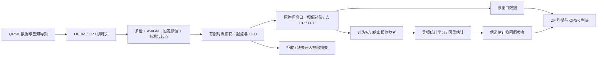
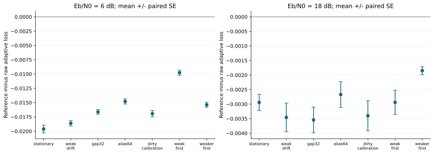
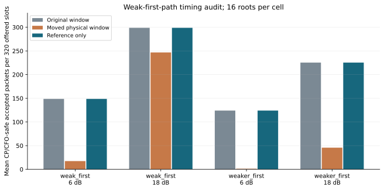
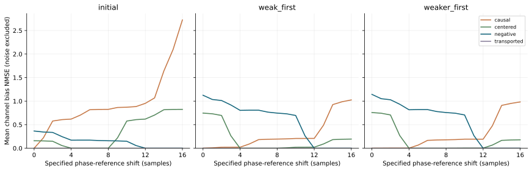

# WaveLink 项目总报告

**项目实践 / 科研实践｜电磁场与无线技术·通信方向｜Python｜SISO OFDM**

当前交付版本 v0.25。项目研究信道统计失配与非理想同步下的接收退化：在固定发送预算、只使用可获得的导频及训练头信息时，统计学习和因果更新能改善什么，又会在哪些条件下失效？

## 1. 系统与信息边界

统计门限仅决定哪些观测进入模型学习，已经接受的数据仍输出并计分。真实瞬时信道、真实包起点、真实 CFO、真实安全标签仅供评估或明确标注的 Oracle 对照，不传入实际接收分支。

最新突发协议采用 64 点酉 FFT、16 点 CP、28 个梳状导频和 24 个数据子载波；每段初始 64 个校准时隙，随后计分 320 个时隙。多径在单个突发内静态，跨突发改变统计分布；不把这种变化称为连续多普勒。

## 2. 从基线到研究问题

| 环节 | 已实现与比较 | 核查入口 |
| --- | --- | --- |
| 通信正确性 | 单位能量 QPSK、酉 FFT、CP、AWGN 理论 BER、充分 / 不足 CP 对照 | [AWGN](awgn.md)、[多径](multipath.md) |
| 估计先验 | 插值 LS、时域 LS、LMMSE；PDP、噪声和时延范围失配 | [LMMSE](lmmse.md)、[统计学习](learned.md) |
| 时间变化 | 因果更新、漂移触发、创新监测、延迟复核与告警恢复 | [延迟复核](followup.md)、[冻结泛化](generalization.md) |
| 接收前端 | 包起点与 CFO 捕获、缺失、错误接受与观测时钟 | [捕获](acquisition.md)、[捕获后跟踪](captured_tracking.md) |
| 弱首径与坐标 | 物理移窗、保留原窗的相位参考、带符号时延先验 | [相位参考](reference.md)、[先验审计](support.md) |

主要研究产出是有边界的实验性改进和对照证据，不宣称论文级原创算法或完整无线标准实现。

## 3. 三个代表性发现

### 3.1 相位参考可改善特定工作负载的损失

v0.21 固定前一阶段参数，在 7 种场景、2 个 Eb/N0、每单元 16 个新根种子上共享样本比较 8 个接收方法，共 224 个场景 / SNR / 种子组合。统计参考自适应在这 14 个单元的平均损失均低于原窗口自适应。

例如 weak_drift、18 dB：原窗口自适应损失 **0.0168595**，统计参考自适应 **0.0134029**，相对下降约 **20.5%**；配对差为 **−0.0034566 ±0.0004922 SE**。该数字仅适用于指定场景和对照，不能写成所有条件下 BER 下降 20.5%。损失为 `(误码比特+擦除比特)/全部提供比特`，包含拒收和缺失。

图 1：完整 320 时隙的整段配对差；误差条为 16 个根种子的一个标准误，并非 95% 置信区间。各场景共享随机流，不能当作额外独立重复。

### 3.2 平均损失改善不等于物理窗口正确

直接移到显著训练抽头，可能跳过弱首径。weak_first、6 dB 中，原窗平均 **148.6875** 个包满足充分 CP/CFO 安全判据，物理移窗后只剩 **17.4375** 个，平均新增 **131.3125** 个原安全而变为非安全的包。保留原窗的相位参考分支不改变这个窗口序列，因此没有由移动新增的风险，但原捕获错误仍存在。

图 2：每段提供 320 个计分包，安全计数只在已接受包中统计。判据使用真实最大时延及残余 CFO≤0.05，仅用于评估；违反充分条件不意味着该包必然高误码。

代价也必须保留：weak_first、6 dB 中，相位参考自适应损失 **0.338094**，高于物理移窗自适应的 **0.337589**；配对差 **+0.000506 ±0.000140 SE**。本机旧阶段运行成本审计也显示，延迟复核虽减少重建次数，在线时间仍比增量周期对照高约 **8.2%–13.4%**，没有证明加速。这些是不同阶段的独立工作负载，不能把耗时结论直接套到最新前端。

### 3.3 改变坐标与改变先验必须分开解释

将相位坐标与时延支撑一起移动，LS 应还原原估计器。v0.22 的 816 条对应控制记录中，最大逐元素差约 **4.35×10⁻¹⁴**。如果旋转后仍固定使用 0…16 抽头，实际上改变了物理先验。

图 3：理想对角信道中的偏差 NMSE，不含噪声项，也不是端到端 BER。四种支撑预先声明，未使用真实标签选择最佳方法。

在 weaker_first、指定移动 12 个样本时，causal 模型的 13/16 个观测块通过导频门限，但这些通过者的信道偏差 NMSE 平均仍为 **0.108575**。因此门限通过不能认证模型正确；固定负时延支撑也不适合全部移动量。

## 4. 证据可信度与独立实现核对

- 开发 / 测试种子分离、参数冻结、共享样本配对比较；完整与晚期窗口重叠，不当作独立重复。
- 保存逐段误码、擦除、更新事件、统计摄入掩码、窗口哈希及来源；拒收不作为零误码。
- `make check` 聚合自动测试、报告哈希校验、无噪声回环、四段旧案例复跑和独立数值核对。旧案例复跑不增加新统计证据。
- v0.23 新增不导入 NumPy / WaveLink 的 Python 标准库参考：直接 DFT、逐样本卷积和带主元消元；与生产实现的 FFT、SVD 和线性求解比较。4 个新数值夹具根种子 × 2 种噪声方差，共 8 个案例，最大差 **9.97×10⁻¹⁴**，硬判决全部一致。这是同语言、不同实现的交叉核对，不是 MATLAB、硬件或形式化验证。
- 本机 212 项自动测试通过；Linux / Python 3.11、3.13 的 GitHub 自动检查配置另行运行，远端执行结果以 [Actions](https://github.com/Palpitate-kkkk/wavelink/actions) 为准。

[独立参考代码](../validation/reference_receiver.py) · [交叉核对记录](../reports/crosscheck/runs.csv) · [来源](../reports/crosscheck/metadata.json) · [复现说明](reproduction.md)

## 5. 固定时隙文件回放

v0.24 提供明确格式的 `.npy` 复基带文件输入、已知导频和可用性标记，接收机独立输出判决、擦除和因果事件。96 个合成时隙的文件路径与原内存路径逐位一致；其中 91 个时隙输出判决、1 个拒收、4 个缺失，输出中仍有 5,421 个误码，不把判决输出当作正确接收。输入文件不包含真实载荷、起点、频偏和抽头；真值仅由评分器持有。详见 [I/Q 回放接口](iq_replay.md)。

v0.25 补充 [SigMF 子集导入](sigmf.md)：单通道复浮点 / 复整数文件、显式样本选择和整数缩放、源 / 转换 / 接收指纹链。三种编码均与直接输入相同量化数据的路径一致；故意削顶会显著改变采样与判决，未把个别误码减少解释成性能收益。所有数据仍由仿真生成。

## 6. 当前交付与下一阶段边界

已交付：可安装源码、212 项测试、阶段协议与报告、三张可再生成的 SVG、四段保存结果复跑、独立数值核对、GitHub 自动检查配置、[简历与面试提纲](presentation.md)。

当前未完成：真实 SDR / IQ 录制数据、连续多包检测、真实连续多普勒、分数时延、编码链路、MIMO、硬实时部署和跨硬件性能保证。前端弱首径判定与旋转后的支撑选择仍有反例。当前适合按“通信算法仿真与可复现实验平台”展示，下一阶段应针对一个明确缺口另立协议。
