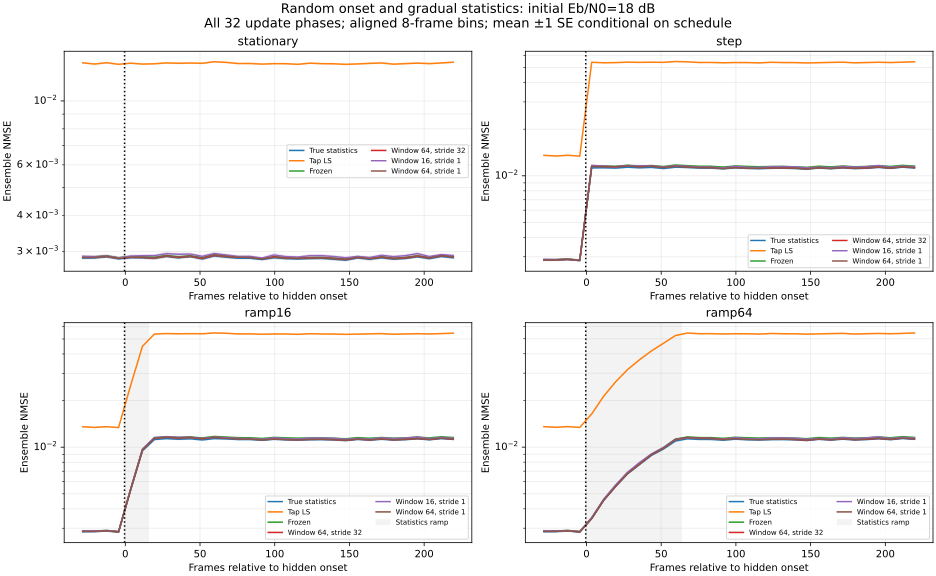

# 随机变化相位与缓变统计的稳健性评测

本阶段检验上一阶段的周期/滑动窗口更新收益是否依赖固定变化点。采用预先固定的全相位分层设计，并加入 16/64 帧的功率统计渐变。保留相同接收机、学习公式、初始校准和因果规则，没有根据测试结果选择策略。

## 时间设计和物理模型

沿用 64 点 SISO QPSK OFDM、CP=16、导频间隔 4、L=13、每帧 20 个计分符号及一个预热符号。每帧独立生成不相关零均值复高斯抽头，帧内固定；这里只让帧之间的总体统计缓慢变化，不等于实现了连续多普勒信道或相关衰落轨迹。

初始/最终 PDP 与 [上一阶段](drift.md) 相同：时延 0/4/12 的平均功率从 0.80/0.12/0.08 变为 0.10/0.20/0.70。非零时延集合保持不变，最大时延为 12 样本，CP 足够。最终噪声功率是初始值的 4 倍。

每段链路先独立校准 64 帧，再计分 320 帧。通过 `schedule_seed=72001` 对相位 0..31 做一次随机排列，分别指派给 32 个独立的信道/噪声种子，变化起点为 `start=64+phase`。因此一次覆盖周期更新的全部 32 种相位，避免上一阶段恰好对齐更新边界；起点分配与接收数据无关。不是独立同分布地随机抽取 32 次起点，而是随机排列的均衡分层设计。

相同种子的起点在所有场景和两个初始信噪比之间复用，配对结果保持可比。32 个起点只覆盖帧 64..95，尚未检验更长静态间隔、任意时刻或多次改变。

| 场景 | 变化形式 | 参数到达终值的时间 |
|---|---|---|
| stationary | 统计不变，起点仅用于评价对齐 | 无实际变化 |
| step | 同时改变 PDP 与噪声 | start |
| ramp16 | 16 帧线性功率渐变 | start+15 |
| ramp64 | 64 帧线性功率渐变 | start+63 |

渐变权重为 `alpha[t]=clip((t-start+1)/R,0,1)`，阶跃为 `alpha[t]=1[t>=start]`。真实 PDP 为 `(1-alpha)p_initial+alpha p_final`，噪声功率为 `N0_initial(1+3alpha)`；插值对象是功率，不是复抽头或 dB。每帧总体平均信道总功率仍为 1，不逐帧强制归一化。

初始总发送 Eb/N0 为 6 或 18 dB。变化场景的实际 Eb/N0 随时间为 `initial_dB - 10 log10(1+3alpha)`，终值约 -0.0206/11.9794 dB。渐变场景早期噪声较小，不能把其较低的绝对 BER 直接解释为更新算法更好；只在同一轨迹内做配对策略比较。

## 接收机与因果隔离

比较 frozen、64 帧窗口每 32 帧更新、16/64 帧窗口每帧更新，并保留真实瞬时 CSI、每帧真实总体统计 LMMSE、线性 LS、时域 LS。每种学习策略从同一个完整 64 帧校准模型开始。真值和渐变权重只进入生成器及理论评价器，更新器不接收起点、相位、场景或变化速度。

`estimate() → 计分 → advance()` 时序沿用上一阶段，当前统计矩阵 A[t] 只能由 t-1 及之前帧形成；当前导频可以用于当前信道估计，但统计量最早供下一帧使用。更新周期从测试链路开始计数，不在变化起点重置；末帧不做无后续用途的更新。

逐帧断言模型的训练帧索引小于当前帧。自动测试还验证旧的固定阶跃数据、显式阶跃与旧路径的逐帧结果一致，以及改变未来渐变后缀不会影响起点之前的输出。旧基准回归选取上一阶段一段完整链路的 32 条阶段结果，比较保存的错误数、BER、NMSE 和预测 NMSE，防止扩展生成器时悄悄改变原有结果。

## 评价窗口、样本与不确定性

按各链路的真实起点对齐评价，接收机本身不知道这些评价边界：

- pre：相对帧 -32..-1，共 32 帧。
- post_early：相对帧 0..63，共 64 帧，覆盖所有预设渐变过程。
- post_late：相对帧 160..223，共 64 帧，已经经过最大 64 帧渐变、64 帧历史窗口和 32 帧更新周期的保守等待界限。
- post_all：相对帧 0..223，共 224 帧，包含恢复过程；与 early/late 重叠。

late 开始位置在运行前写入配置，并由校验器检查，不根据结果调整。它是延迟后的评测窗口，不是实测“恢复时间”；本阶段没有定义数据驱动的收敛阈值。

4 场景 × 2 个初始信噪比 × 32 个种子，共按场景计分 256 段链路、81,920 帧、117,964,800 比特。场景复用相同潜在随机流，独立 seed/snr 流为 64 组，包含 29,491,200 个发送比特；不是 1.18 亿独立比特。初始校准池跨场景复用，独立 seed/snr 下共 4096 帧。

每种“场景 × 初始信噪比”有 32 个完整链路结果，各相位一个。给定这次固定相位分配后，信道/噪声重复独立，但期望误差可能随相位变化。报告整段链路均值的样本 SE；它在期望意义上包含相位均值差异带来的额外项，对固定分层均值的采样方差是保守估计。它不是任意随机起点总体的无条件置信区间，也不等于按帧独立计算的 SE。

配对差先在同一链路内计算，再跨 32 个独立噪声/信道种子求均值与 SE，同时保存相对 frozen 和相对 periodic 的结果。图按相对起点的 8 帧分箱，阴影为均值 ±1 SE，不是 95% 置信区间。场景之间共享随机流，不能把场景当成更多独立重复；重叠评价窗口也不能累加为更多样本。

理论 NMSE 对每帧真实总体协方差、真实噪声及更新前的 A[t] 计算，公式沿用 [漂移报告](drift.md)。以各链路“观测减预测”的平均残差及链路级 SE 做固定六 SE 回归检查；Oracle BER 使用同样的链路残差规则。该规则为工程一致性检查，没有多重比较显著性校正。

## 本次结果

8192 行逐链路阶段结果、256 个汇总点已保存。224/224 个非 Oracle NMSE 残差检查、32/32 Oracle BER 检查通过；51 项测试通过，包括旧路径回归、全相位覆盖、渐变端点与未来轨迹隔离。

下表是初始 6 dB 的 step 场景，变化后实际 Eb/N0 约 -0.0206 dB。每个阶段、每种方法分别计分 2,949,120 比特，early=相对帧 0..63，late=160..223。

| 策略 | early BER | early NMSE | late BER | late NMSE |
|---|---:|---:|---:|---:|
| frozen | 0.236162 | 0.170990 | 0.235824 | 0.170287 |
| periodic_64_32 | 0.234243 | 0.162378 | 0.230088 | 0.140008 |
| rolling_16 | 0.231483 | 0.148165 | 0.230863 | 0.144280 |
| rolling_64 | 0.232992 | 0.155989 | 0.230039 | 0.139942 |
| 真实统计 LMMSE | 0.229791 | 0.138618 | 0.229740 | 0.138360 |

early 中 rolling_16 相对 periodic 的配对 BER 差为 `-0.00276015 ± 0.00020103`（±1 SE）；late 则为 `+0.00077515 ± 0.00016794`。小窗口的早期恢复与后期波动存在取舍，不能只看恢复后的一段平均。late 中 rolling_64 相对 periodic 的 BER 差为 `-0.00004883 ± 0.00006409`，这个差异比 1 SE 还小，不能据此认定逐帧更新的 BER 更优或统计等价。

在三种变化轨迹各自的 early 阶段、初始 6 dB 下，rolling_16 相对 periodic 的配对 BER 差为：

| 轨迹 | BER 差（rolling_16 − periodic） | 1 SE |
|---|---:|---:|
| step | -0.00276015 | 0.00020103 |
| ramp16 | -0.00244887 | 0.00015203 |
| ramp64 | -0.00057543 | 0.00013049 |

以上均为同一轨迹内的比较，不将不同轨迹的绝对 BER 用作算法优劣证据，也不声称每一个相位都改善。每个相位目前只有一段独立链路，尚不能可靠估计单独相位的性能分布。

统计不变时，初始 6 dB 的 early 中 rolling_16 相对 frozen 的 BER 差为 `+0.00027635 ± 0.00008898`，NMSE 为 0.042044，对照 frozen 为 0.041148。更新样本波动会产生代价，不能认定持续更新总是更好。

初始 18 dB 时收益仍较小。例如 step 的 early：periodic BER=0.03136698、frozen=0.03144836，配对差为 `-0.00008138 ± 0.00002685`。本报告不将其描述为大幅性能提升，也未进行多重比较后的显著性判定。

step、ramp16、ramp64 的 late 数值逐项相同。这是设计的预期：它们共用潜在随机流、最终 PDP/噪声相同，late 前所有有限历史窗口已经不含变化过程，固定周期位置也相同。三个相同结果不能作为三次独立复现或进一步的泛化证明；主要区别在恢复阶段和 post_all。




## 更新成本和复现

每段 320 帧最多有 319 次能影响未来预测的更新机会。窗口与拟合方法未优化，计数与实际计时分开：

| 策略 | 模型重建次数 | 累计拟合帧访问数 |
|---|---:|---:|
| frozen | 0 | 0 |
| periodic_64_32 | 9 | 576 |
| rolling_16 | 319 | 5104 |
| rolling_64 | 319 | 20416 |

所有策略复用既有导频，初始 64 帧校准开销相同。`costs.csv` 保存重建次数、窗口大小、因果审计及 wall-time 诊断；诊断计时不是经过隔离负载和线程控制的正式延迟基准，不据此宣称实时能力。

```bash
python -m pip install -e '.[plots]' -c experiments/requirements.txt
python -m unittest discover -s tests -v
python -m experiments.robustness_ber --output results/robustness --plot
```

[起点与阶段边界](../reports/robustness/schedules.csv) · [逐链路阶段结果](../reports/robustness/runs.csv) · [汇总与配对 SE](../reports/robustness/summary.csv) · [对齐轨迹](../reports/robustness/trace.csv) · [成本和因果审计](../reports/robustness/costs.csv) · [命令、环境、种子和源码哈希](../reports/robustness/metadata.json)

metadata 的 base_commit 为运行前父提交，dirty 标记表示生成时尚未提交，实际代码由源码 SHA-256 确定。计时、SVG 元数据和平台字段可能不同，数值结果应可复现。

## 当前适用边界

该设计检验的是一次功率统计改变的更新相位与渐变速度，仍保留已知 L、理想同步、整数时延、足够 CP、不相关零均值抽头和帧内静态假设。未覆盖新时延出现、帧内运动、频偏、反复变化或真实无线采集。下一步可在独立开发/测试流上确定基于观测的更新触发规则，并与固定周期策略比较；不能按本次测试结果直接挑阈值后再当成泛化结论。
