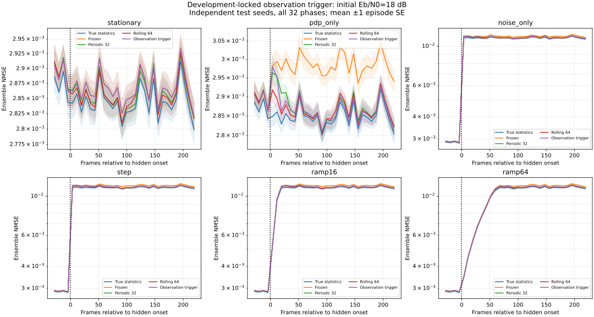

# 独立开发流定阈值的观测触发更新

本阶段加入一个仅使用导频观测的启发式更新触发器。先在开发流上选择阈值，保存锁定文件，再运行完全不同种子的测试流；测试结果不用于重新选择阈值。研究目标是在保持信道估计质量的同时减少模型重建，并测量误触发与变化后迟迟不更新的情况，不宣称新检测理论。

## 模型与触发分数

物理模型、PDP、导频、能量定义和因果规则沿用 [全相位/缓变阶段](robustness.md)。64 点 OFDM，CP=16，16 个导频、36 个数据子载波，L=13，帧内静态独立高斯抽头，每帧 20 个计分符号。仍然假设已知时延上界、理想同步、不相关零均值抽头和单位模导频。

对已计分帧的相除导频 `z=Yp/Xp`，预计算 `B=Fp†`。每帧只形成如下特征：

- `u_l = |[B mean_t(z)]_l|²`，长度为 L 的抽头功率矩。
- `v = mean |z[2q+1]-z[2q]|² / 2`，不重叠符号对给出的噪声功率矩。

维护最近 64 帧拟合窗口和最近 16 帧监测窗口的这些矩的滚动和。窗口统计为 `Nhat=max(mean(v),1e-12)`、`p_raw=mean(u)-Nhat/T × diag(BBᴴ)`、`phat=max(p_raw,1e-12)`，与之前批量学习公式数值等价，单元测试交叉核对原始功率和噪声。

每完成 8 个计分帧检查一次，比较监测窗口与当前已部署模型的统计：

`noise_score = |log(N_recent / N_model)|`

`pdp_score = ||p_recent - p_model||₁ / max(sum(p_model),1e-12)`

`score = max(noise_score, pdp_score)`

若 score **严格大于**锁定阈值，而且距上次触发至少 32 帧，才用最近 64 帧缓存矩重建 LMMSE。第一次触发不受初始冷却期限制；以后冷却只抑制重建，不停止特征累积或每 8 帧一次的检查。两个分数组合是预先定义的启发式，不是显著性检验或经过校准的变化概率。

当前帧先用旧矩阵估计并计分，之后才生成特征、检查并可能重建，最早供下一帧使用。运行时接口只获得已知导频和接收数据，不获得真实 PDP、噪声、BER、变化时刻或渐变速度。开发阶段可以使用仿真真值评价候选，但运行时不使用这些标签。

## 开发、选择、冻结、测试

配置在运行前固定：候选阈值 0.25/0.50/0.75/1.00；监测窗口 16、拟合窗口 64、检查步长 8、冷却 32 不随结果调整。

开发流使用 8 个独立信道/噪声种子 81001..81008 和 schedule_seed=82001；从 32 相位随机排列中取前 8 个，不宣称开发集覆盖全部相位。测试流使用 91001..91032 和独立 schedule_seed=92001，覆盖全部 32 种相位。开发/测试信道噪声种子集合不相交。初始校准与测试时序使用各自 role 随机流，场景内所有方法共享数据。

两套流都包含 6 个场景：统计不变、仅 PDP 阶跃、仅噪声阶跃、两者阶跃、两者 16 帧渐变、两者 64 帧渐变；初始 Eb/N0 为 6/18 dB。它们是同一预设分布族中的独立重复，不是未见过的传播分布。起点为 64 加相位，仍不传给接收机。

开发规则对 post_all（相对帧 0..223）做如下约束：

1. 每个“场景 × 初始信噪比”的候选平均 NMSE 都不得超过周期更新平均 NMSE 的 1.05 倍，不用全场景平均掩盖最差条件。
2. 统计不变场景中，平均每段 320 帧链路最多重建一次。
3. 满足两个条件后选择平均重建次数最少的候选；若全部不满足，明确标为约束未达到，再按最差 NMSE 比优先回退，不偷偷扩充网格。

本次开发结果：

| 阈值 | 最差条件 NMSE / periodic | 每段平均重建 | 静态场景平均重建 | 可选 |
|---|---:|---:|---:|---|
| 0.25 | 1.00284 | 7.45833 | 6.31250 | 否，静态更新超限 |
| 0.50 | 1.01285 | 3.36458 | 1.00000 | 是 |
| **0.75** | **1.02989** | **2.25000** | **0.18750** | **是，重建更少** |
| 1.00 | 1.05874 | 1.71875 | 0.06250 | 否，估计误差超限 |

最终固定阈值 **0.75**。`selection.json` 在任何测试链路运行前写入，包含选择原因、所有候选结果、开发汇总和成本文件哈希、配置及源码哈希和 UTC 时间。程序随后运行测试，并验证锁定文件与源码未发生改变。metadata 保存锁定文件 SHA-256 及测试开始时间。该记录提供可复现的执行顺序，不是第三方时间戳认证。

5% 是预设的观测均值工程容差，不是统计非劣效界限检验，不能据此宣称统计上等价或必然保持准确率。

## 评价指标与误触发口径

沿用相对起点的 pre=-32..-1、early=0..63、late=160..223、post_all=0..223；late 只是固定后期窗口，不能保证事件策略已经触发或适应。逐帧 NMSE 理论预测使用计分前的 A[t] 和评价器的真实总体统计。以独立整段链路为统计单位，报告相对 frozen 和 periodic 的配对 BER/NMSE 差与 SE；滑动帧和重叠窗口不当成独立样本。给定分层相位分配后的 SE 口径及限制与上一阶段相同。

触发质量按可核验的操作定义记录于 `detection.csv`：

- 变化前触发次数：`after_frame < onset`；静态场景的所有重建都额外记为静态误触发。这里“误”仅表示没有真实统计改变，不是经校准的假警概率，也不代表重建一定降低性能。
- 首次变化后更新延迟：首次 `after_frame >= onset` 的重建开始生效帧相对 onset 的距离，即 `after_frame-onset+1`。它可能碰巧来自有限样本波动，不能保证每次都是因果识别了变化。
- 64 帧观测内未触发：延迟为空或大于 64；与整段链路从未在变化后触发分开报告。未触发条目的延迟留空，不按零延迟纳入均值。

逐次 `trigger_events.csv` 保存 after_frame、applies_from_frame、两个分数、总分、估计噪声比和 PDP 误差；后两者只用于真值评价。接收机只看分数，不看评价误差。

## 独立测试结果

测试阈值保持 0.75。12/12 个“场景 × 信噪比”的 post_all 观测 NMSE 均值比均小于 1.05，最差为 ramp16、初始 6 dB 的 **1.01952**。这满足本次预设的均值工程容差，但不构成统计非劣效或零精度损失的证明。

测试共 384 个按场景计算的链路、122,880 个计分帧、176,947,200 个场景计分比特。六种场景复用同一 seed/snr 的潜在随机流，独立 seed/snr 流为 64 组，发送比特为 29,491,200，不能把重复场景计分当成更多独立比特。开发流另有 16 组独立 seed/snr 潜在流，不与测试流重合。

保存 12,288 行测试链路阶段结果、384 个测试汇总点，以及 3840 行开发链路阶段结果。开发 432/432 NMSE、48/48 Oracle BER 检查，测试 **336/336 NMSE、48/48 Oracle BER 检查**通过；57 项单元/集成测试通过，包括缓存矩与批量拟合一致、冷却、先计分后触发、未来观测隔离、开发/测试种子隔离和旧基准回归。

按预设六场景、两档信噪比等权汇总，事件策略每段平均重建 **2.26302** 次（范围 0..4），周期策略固定 9 次、逐帧策略固定 319 次。事件策略总重建 869 次，相对周期 3456 次少约 **74.9%**；这仅是矩阵重建计数，不是总体计算量或运行时间减少比例。

初始 6 dB、PDP/噪声共同阶跃时，变化后实际 Eb/N0 约 -0.0206 dB；下表为 post_all 的 224 帧，32 条链路每种方法计分 10,321,920 比特。平均重建数统计整段 320 帧，阶段指标和成本的范围不同。

| 方法 | post_all BER | post_all NMSE | 每段平均重建 |
|---|---:|---:|---:|
| frozen | 0.237441 | 0.173392 | 0 |
| periodic_64_32 | 0.232203 | 0.146684 | 9 |
| rolling_64 | 0.231728 | 0.144453 | 319 |
| triggered | 0.232659 | 0.149222 | 2.90625 |

在这个条件下，triggered 相对 periodic 的配对 BER 差为 **+0.00045631 ± 0.00008965**，NMSE 差为 **+0.00253783 ± 0.00047489**（±1 SE）。重建减少伴有可见的误差代价，不能将本次结果描述成无损替换。相同条件下 early 的 BER 差为 +0.00002814 ±0.00007523，后续保持较旧模型的时段也计入 post_all，不能只挑 early 展示。

静态场景中，64 条独立 seed/snr 链路有 7 条各出现一次重建：6 dB 为 5/32 条、18 dB 为 2/32 条，平均每段分别为 0.15625/0.06250 次。这里是实测操作计数，不是经过校准的假警率。

五种变化场景 × 两档信噪比的 320 个场景链路中，全部在 64 帧观测内发生至少一次变化后重建，没有观测到漏更新。它们跨场景复用潜在流，不能用 320 次独立二项试验推导漏检概率上界。首次更新也不代表信道统计已经准确恢复。

| 场景 | 首次变化后更新的平均延迟：6 / 18 dB（帧） |
|---|---:|
| PDP-only | 14.00 / 12.75 |
| noise-only | 10.75 / 10.50 |
| step | 10.50 / 10.50 |
| ramp16 | 17.75 / 16.75 |
| ramp64 | 34.75 / 34.75 |

各子图纵轴范围独立，不能仅凭视觉起伏比较误差幅度。阴影为 1 SE，不是 95% 置信区间。




## 计算成本的边界

周期更新仍每段重建 9 次，逐帧 64 窗口重建 319 次。事件策略额外进行 319 次在线特征累积、39 次监测检查，初始化时还处理 64 个校准帧特征；重建数取决于观测。

每帧特征成本约 O(T Np + L Np)，滚动和更新及监测约 O(L)，模型构造仍需求解导频协方差系统。缓存矩避免触发时重新扫描 64 帧，`fit_frame_visits=0` 仅指重建时不重读窗口，不表示没有计算。`feature_frames=383` 包括校准 64 帧与在线 319 帧，最后一帧不做无后续用途的更新。基线该列为 0 表示不使用新增特征代码，不表示基线零计算。

历史原始导频仍保留以兼容共同接口，另有两个矩窗口，尚未最小化存储。周期/逐帧基线尚未做同等增量缓存优化，因此诊断计时差不能单独归因于触发策略。报告分别保存 feature_ms、monitor_ms、total_update_ms、initial_fit_ms，未做隔离系统负载和线程的正式延迟基准，不声称整体加速倍数或实时性。

## 复现

```bash
python -m pip install -e '.[plots]' -c experiments/requirements.txt
python -m unittest discover -s tests -v
python -m experiments.triggered_ber --output results/triggered --plot
```

默认命令按“开发→保存冻结文件→测试”完整执行。结果目录包括开发逐链路/汇总/成本/触发诊断、selection.json，以及测试 runs/summary/trace/costs/schedules/detection/trigger_events/test_gates 和 metadata。固定种子下数值应可复现，计时、平台、UTC 时间和 SVG 元数据可能变化。base_commit 为运行前父提交，具体源码由哈希确定。

当前规则依赖已知 L、帧内静态和不相关抽头模型。未覆盖新时延出现、帧内多普勒、连续相关衰落、反复改变、实测协方差或硬件部署。开发/测试虽分离，场景族、终值和信噪比仍相同；需在额外未见分布上检验后才能讨论更广泛的泛化。

[冻结选择记录](../reports/triggered/selection.json) · [开发结果](../reports/triggered/development_summary.csv) · [测试结果与配对 SE](../reports/triggered/summary.csv) · [逐条件均值容差](../reports/triggered/test_gates.csv) · [误触发及更新延迟](../reports/triggered/detection.csv) · [触发事件](../reports/triggered/trigger_events.csv) · [计算诊断](../reports/triggered/costs.csv) · [执行顺序及源码哈希](../reports/triggered/metadata.json)
